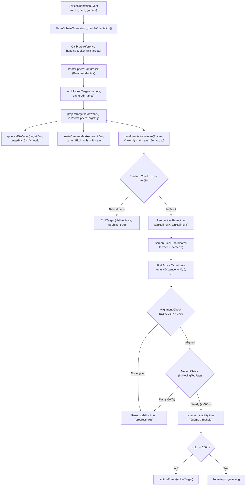

# PHOTOSPHERE DIAGNOSTIC INSTRUMENTATION REPORT

**Project:** `E:\Vanji\7days-Field`  
**Target:** Reproducing Google Camera Photo Sphere behavior on Android physical devices  
**Status:** Diagnostic instrumentation added; 89/89 Vitest tests passing; production build clean.

---

## 1. Complete Target-Projection Code Path

The actual code path executing across files for each orientation frame and capture tick:

### Key Functions and File Locations:

1. **Orientation Reception & Smoothing:**
   - File: [`src/features/photo-sphere/PhotoSphereOrientation.js`](file:///e:/Vanji/7days-Field/src/features/photo-sphere/PhotoSphereOrientation.js)
   - Function: `_handleOrientation(event)`
   - Computes:
     - `rawPitch = Math.max(-90, Math.min(90, beta - 90))`
     - `pitch = rawPitch - referencePitch`
     - `rawYaw = normalizeAngle(alpha)`
     - `relYaw = normalizeAngle(rawYaw - referenceHeading)`
     - `angularVelocity`: EMA filtered delta angle over `dt` with noise threshold ($0.08^\circ$).
     - `isMovingTooFast`: Hysteresis speed flag ($>50^\circ/\text{s}$ trip, $<32^\circ/\text{s}$ clear).

2. **Target Generation & Physical 3D Unlocking:**
   - File: [`src/features/photo-sphere/PhotoSphereTargets.js`](file:///e:/Vanji/7days-Field/src/features/photo-sphere/PhotoSphereTargets.js)
   - Functions:
     - `generateSphericalTargets()`: 30 targets covering the entire 360° × 180° sphere.
     - `getUnlockedTargets(targets, capturedFrames)`: Returns target 0 initially; after each capture, unlocks the 4 physical 3D adjacent neighbors (Right, Left, Above, Below) around every captured photo.

3. **Coordinate Transformation & Perspective Projection:**
   - File: [`src/features/photo-sphere/PhotoSphereTargets.js`](file:///e:/Vanji/7days-Field/src/features/photo-sphere/PhotoSphereTargets.js)
   - Functions:
     - `sphericalToVector(targetYaw, targetPitch)`: World-space unit vector $V_{\text{world}}$.
     - `createCameraMatrix(yawDeg, pitchDeg, rollDeg)`: 3×3 rotation matrix $R_{\text{cam}}$.
     - `transformVectorInverse(R, v)`: Transforms world vector to camera space: $V_{\text{cam}} = R_{\text{cam}}^T \cdot V_{\text{world}} = [x_c, y_c, z_c]$.
     - `projectTargetToViewport(...)`: Frustum culls targets with $z_c \ge -0.05$; projects $x_c, y_c$ to screen pixels using portrait-scaled field of view: $\tan(\theta_v / 2) = \tan(\theta_h / 2) \cdot (H / W)$.

4. **Gating, Reticle Alignment, and Shutter Decision:**
   - File: [`src/features/photo-sphere/PhotoSphereCapture.jsx`](file:///e:/Vanji/7days-Field/src/features/photo-sphere/PhotoSphereCapture.jsx)
   - Finds closest active target to optical center.
   - Evaluates `activeDist <= 3.0` degrees.
   - Runs 280ms hold timer; triggers `captureFrame(activeTarget)`.

---

## 2. Sensor and Camera Coordinate Conventions

| Space | Axis | Direction / Meaning |
|---|---|---|
| **World Space** | $+X$ | Right / East |
| | $+Y$ | Up / Zenith |
| | $-Z$ | Forward / Bore Sight (at reference calibration) |
| **Camera Space** | $+X_c$ | Screen Right |
| | $+Y_c$ | Screen Up |
| | $-Z_c$ | Optical bore sight (straight out through back camera lens) |
| **Screen Space** | $X$ | $0$ (left) to `viewportWidth` (right); Center = $W / 2$ |
| | $Y$ | $0$ (top) to `viewportHeight` (bottom); Center = $H / 2$ |
| **Sensor (W3C)** | $\alpha$ | Compass azimuth / heading: $0^\circ$ to $360^\circ$ |
| | $\beta$ | Device pitch tilt: $-180^\circ$ to $+180^\circ$ ($+90^\circ$ upright portrait) |
| | $\gamma$ | Device roll tilt: $-90^\circ$ to $+90^\circ$ |

---

## 3. Diagnostic Instrumentation Added

A zero-overhead, development-only diagnostic HUD has been implemented in:
[`src/features/photo-sphere/components/PhotoSphereDiagnosticsOverlay.jsx`](file:///e:/Vanji/7days-Field/src/features/photo-sphere/components/PhotoSphereDiagnosticsOverlay.jsx)

It is active during `npm run dev` or by appending `?diag=true` to any URL on mobile.

### Real-Time Telemetry Exposed:

1. **Raw Sensors:**
   - Raw W3C `alpha`, `beta`, `gamma` values.
   - `screenOrientationAngle` ($0^\circ, 90^\circ, 180^\circ, 270^\circ$).
2. **Calibrated Reference Frame:**
   - `relYaw` (current heading relative to calibrated bore sight).
   - `relPitch` (current pitch relative to calibrated bore sight).
   - `angularVelocity` in degrees/second.
   - `isMovingTooFast` boolean status (`FAST` vs `STEADY`).
3. **Target & Projection:**
   - Current Target ID and count of unlocked floating targets.
   - World target coordinates $(\text{yaw}^\circ, \text{pitch}^\circ)$.
   - Camera-space vector $[x_c, y_c, z_c]$.
   - Lens frustum culling flag `isBehind`.
   - Screen pixel coordinates $(x, y)$.
   - Viewport dimensions $(W \times H)$.
   - Angular error in degrees.
4. **Decision Gating:**
   - Camera Ready status.
   - Alignment check ($\le 3^\circ$).
   - Stability hold percentage ($0\%$ to $100\%$).
   - Exact text reason an automatic capture is accepted or rejected (e.g. `Aligning dot (14.2° > 3.0°)`, `Moving too fast (54.1°/s > 50°/s)`, `Holding steady (45%)`, `Aligned & steady: trigger capture`).

---

## 4. Known Suspected Defects & Discrepancies (For Review)

Without modifying algorithms prematurely, the following discrepancies were identified during inspection:

1. **W3C DeviceOrientation vs. Android Sensor Coordinates:**
   - **Location:** [`PhotoSphereOrientation.js:75-87`](file:///e:/Vanji/7days-Field/src/features/photo-sphere/PhotoSphereOrientation.js#L75-L87)
   - **Inspection Note:** In the extracted APK (`PhotoSphereActivity.java:310`), Android native uses `Sensor.TYPE_ROTATION_VECTOR` and `SensorManager.getRotationMatrixFromVector()`. In web browsers, `deviceorientation` provides Euler angles (`alpha`, `beta`, `gamma`). While `beta - 90` approximates pitch when held upright, Euler angle rotation conventions on mobile WebKit vs Chrome Android can differ when the phone is tilted significantly, occasionally producing gimbal interactions.
2. **Screen Orientation Handling in Landscape:**
   - **Location:** [`PhotoSphereOrientation.js:142`](file:///e:/Vanji/7days-Field/src/features/photo-sphere/PhotoSphereOrientation.js#L142)
   - **Inspection Note:** `screen.orientation.angle` is tracked in diagnostics, but the projection matrix currently assumes portrait orientation as the primary default. If the user rotates the device to landscape ($90^\circ$ or $270^\circ$), `beta` and `gamma` swap physical roles in the W3C spec.
3. **HTML5 `<video objectFit: cover>` Optical Crop Mismatch:**
   - **Location:** [`PhotoSphereCapture.jsx:530`](file:///e:/Vanji/7days-Field/src/features/photo-sphere/PhotoSphereCapture.jsx#L530)
   - **Inspection Note:** The camera stream is rendered with `objectFit: 'cover'`. The physical camera sensor has a native aspect ratio (typically 4:3 or 16:9), while modern smartphones have viewport aspect ratios ranging from 19.5:9 to 21:9. The browser crops the camera preview along the long or short axis to fill the screen. The projection uses the DOM viewport aspect ratio, which may differ slightly from the optical camera crop.

---

## 5. Physical-Device Test Procedure

To collect comparable diagnostic readings on an Android phone:

1. Start the dev server or open the deployed URL with `?diag=true`:
   `https://<your-device-ip>:5173/?diag=true`
2. Open the Photo Sphere camera mode.
3. Tap the **DIAGNOSTICS** badge in the upper left corner to expand the full telemetry panel.
4. Record the following baseline states:
   - **Initial Bore Sight:** With the phone held upright pointing straight ahead, confirm `relYaw: 0°`, `relPitch: 0°`, Target ID `target_0`, screen coordinates near `(W/2, H/2)`.
   - **Horizontal Pan (Right):** Rotate phone $30^\circ$ to the right. Check if `relYaw` increases positively, `x_c` becomes negative, and the dot slides left across the screen.
   - **Vertical Tilt (Up):** Tilt phone $20^\circ$ up toward the ceiling. Check if `relPitch` increases positively, `y_c` becomes negative, and the dot moves down toward the bottom of the screen.
   - **Motion Guard:** Hold phone still for 1 second. Verify `angVel` settles below $10^\circ/\text{s}$ and status indicates `STEADY`. Shake phone quickly to verify `angVel` exceeds $50^\circ/\text{s}$ and status indicates `FAST`.
   - **Capture Lock:** Bring center reticle over dot. Verify `Angular Error` drops below $3.0^\circ$, `Stability Hold` ticks from $0\%$ to $100\%$ over 280ms, and auto-capture executes.
