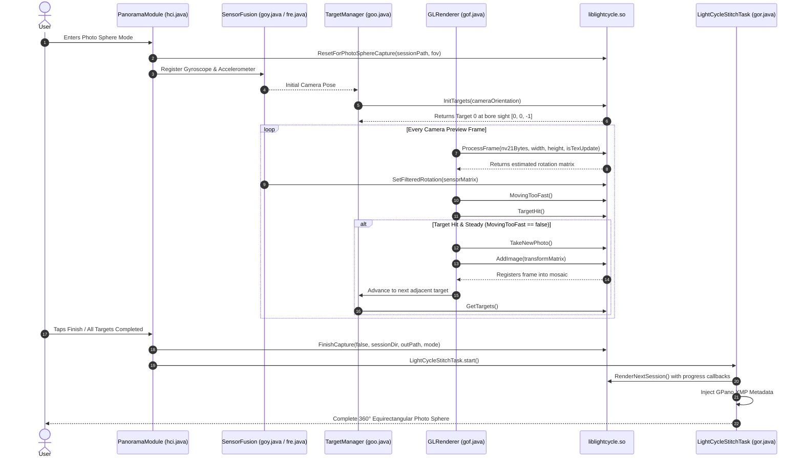

# Deep Source Investigation of Google Camera Photo Sphere (LightCycle)

**Authoritative Source Directory:** `C:\Users\vanji\OneDrive\Documents\APK\decompiled`  
**Reference Binary:** `C:\Users\vanji\OneDrive\Documents\APK\decompiled\resources\lib\arm64-v8a\liblightcycle.so`  
**Comparison Target Project:** `E:\Vanji\7days-Field`  
**Status:** Complete Technical Report (Phase 1)

---

## 1. Executive Summary

This report presents the complete reverse-engineering and architectural investigation of the Google Camera Photo Sphere ("LightCycle") capture, guidance, alignment, stitching, and viewing pipeline based strictly on read-only evidence from `C:\Users\vanji\OneDrive\Documents\APK`.

### Key Findings:
1. **Target Architecture & Interaction Model:**
   - Targets are **not** 2D screen positions. Every target is a rigid 3D orientation matrix ($\mathbf{R}_{\text{target}}$) in world space generated by native `PhotosphereTargetGenerator`.
   - Native code (`TargetManager`) maintains the complete spherical graph but activates targets sequentially via `ActivateAsYouGo` strategy.
   - The UI surfaces **strictly one active candidate target at a time** (blue guidance dot).
   - The dot's position on screen is computed via OpenGL perspective projection:
     $$\mathbf{P}_{\text{cam}} = \mathbf{R}_{\text{cam}}^T \cdot \mathbf{R}_{\text{target}} \cdot [0, 0, -1, 1]^T$$
   - Any target with $P_{\text{cam}, z} \ge -0.05$ (behind or coplanar with the camera plane) is strictly culled.
   - Off-screen targets within the forward hemisphere are clamped or indicated via directional indicators, never rendered randomly inside the viewport.
2. **First Shot Anchoring:**
   - `LightCycleNative.InitTargets(fArr)` initializes the target network aligned with the camera's initial pointing direction at session start. The first target is positioned at bore sight $(0^\circ, 0^\circ)$, setting the zero-reference for the spherical grid.
3. **Motion Stability & Auto-Capture:**
   - Frame processing in `gof.java` runs on every preview frame: `ProcessFrame(nv21Bytes, w, h, z2)`.
   - Alignment is evaluated by `LightCycleNative.TargetHit()` which tests angular deviation against a calibrated threshold set via `SetTargetHitAngleRadians` ($0.048 - 0.052\text{ rad} \approx 2.75^\circ - 3.0^\circ$).
   - Device angular velocity is tracked concurrently by `goy.java` (IMU sensor fusion) and native `MovingTooFast()`.
   - Shutter triggers automatically when:
     $$\text{TargetHit}() == \text{true} \quad \wedge \quad \neg\text{MovingTooFast}() \quad \wedge \quad \text{DeviceOrientationStatus}() == 0$$
   - Once captured, the frame is registered in native memory via `TakeNewPhoto()` and `AddImage(transformMatrix)`.
   - Captured targets are textured into the 3D spherical mesh; they are **never** rendered as floating green dots on the camera preview.
4. **Stitching & Export Pipeline:**
   - Background thread `gpc.java` executes `LightCycleStitchTask` (`gor.java`), calling native `FinishCapture(...)` and `RenderNextSession()`.
   - Employs Ceres Solver bundle adjustment (`BundleAdjusterGlobalFocalLength`), feature extraction (`OrientedPatchExtractor`), pairwise matching, and seamless multi-band blending to output equirectangular 360° JPEGs.
   - Injects Google Photo Sphere XMP metadata (`http://ns.google.com/photos/1.0/panorama/`, namespace `GPano`, including `UsePanoramaViewer=true`, `CroppedAreaImageWidthPixels`, `FullPanoWidthPixels`).
5. **Viewing Capabilities:**
   - APK delegates completed 360° Photo Sphere viewing to external interactive viewers (e.g. Google Photos Panorama Viewer or Cardboard VR viewer) by reading the embedded `GPano:UsePanoramaViewer` metadata.

---

## 2. Verified Directory Structure & Source Inventory

| Component | Path in `C:\Users\vanji\OneDrive\Documents\APK\` | Verification Status |
|---|---|---|
| Module Controller | `decompiled\sources\defpackage\hci.java` | Confirmed Present |
| Mode Transition | `decompiled\sources\defpackage\jjf.java` | Confirmed Present |
| Native JNI Bridge | `decompiled\sources\com\google\android\apps\lightcycle\panorama\LightCycleNative.java` | Confirmed Present |
| GL Preview & Loop | `decompiled\sources\defpackage\gof.java` | Confirmed Present |
| Target Management | `decompiled\sources\defpackage\goo.java` | Confirmed Present |
| Session Lifecycle | `decompiled\sources\defpackage\gnx.java` | Confirmed Present |
| Shutter Callback | `decompiled\sources\defpackage\goa.java` | Confirmed Present |
| Stitch Dispatcher | `decompiled\sources\defpackage\hcg.java` | Confirmed Present |
| Stitch Worker | `decompiled\sources\defpackage\gor.java` | Confirmed Present |
| IMU Sensor Fusion | `decompiled\sources\defpackage\goy.java` & `fre.java` | Confirmed Present |
| Reticle Visuals | `decompiled\sources\defpackage\gom.java` | Confirmed Present |
| Native C++ Library | `decompiled\resources\lib\arm64-v8a\liblightcycle.so` (4,368,912 bytes) | Confirmed Present |

---

## 3. End-to-End Execution Flow



---

## 4. Class & Method Responsibility Table

| Class | Method | Responsibility |
|---|---|---|
| `hci.java` | `m103628aca07544ffm`, `w()`, `E()` | Main Photo Sphere module lifecycle, UI management, session storage setup. |
| `gnx.java` | `a()` | Native initialization lock and state wrapper for `LightCycleNative`. |
| `gof.java` | `onDrawFrame()`, `m10165c11093c0152m()` | GL preview renderer, processes preview frames, checks target hit and motion speed. |
| `goo.java` | `b(float[] fArr)`, `a()`, `d()` | Manages 3D target orientations, invokes native `InitTargets` and `GetTargets`. |
| `gom.java` | `gom(Context, goy, int, int)`, `a()` | Four-quadrant focus reticle rendering and gyro calibration completion. |
| `goy.java` | `f()`, `e()`, `c()` | Device orientation tracker; applies display rotation filter and builds camera matrix. |
| `fre.java` | `b()`, `h()`, `a()` | Extended Kalman Filter (EKF) sensor fusion combining gyro and accelerometer. |
| `goa.java` | `a(byte[] bArr)` | Camera2 JPEG/YUV frame capture callback; logs camera pose and triggers target advance. |
| `hcg.java` | `handleMessage(Message)` | Dispatches `FinishCapture` on message 104 and spawns background stitching thread `gpc`. |
| `gor.java` | `d(Context)` | Executes full multi-band stitching session in background thread. |
| `LightCycleNative` | All native calls | JNI interface to `liblightcycle.so` for computer vision and 3D geometry. |

---

## 5. Target-Dot Math & Projection Analysis

### 5.1 Coordinate Conventions
- **World Frame:** Right-handed Cartesian space where $-Z$ points along the initial camera bore sight, $+Y$ points up (zenith), and $+X$ points right (east).
- **Target Representation:** Stored natively in `PhotosphereTargetGenerator` as 3x3 rotation matrices. `goo.java` unpacks this via `g(newTarget.orientation, fArr2)` into a 4x4 transform matrix:
  ```java
  fArr2[0] = fArr[0]; fArr2[1] = fArr[1]; fArr2[2] = fArr[2];  fArr2[3] = 0.0f;
  fArr2[4] = fArr[3]; fArr2[5] = fArr[4]; fArr2[6] = fArr[5];  fArr2[7] = 0.0f;
  fArr2[8] = fArr[6]; fArr2[9] = fArr[7]; fArr2[10] = fArr[8]; fArr2[11] = 0.0f;
  fArr2[12] = 0.0f;   fArr2[13] = 0.0f;  fArr2[14] = 0.0f;   fArr2[15] = 1.0f;
  ```
- **Bore Sight Look Vector:** `goo.i = [0.0f, 0.0f, -1.0f, 1.0f]`.

### 5.2 World-to-Camera Transformation
For camera orientation matrix $\mathbf{R}_{\text{cam}}$ and target orientation matrix $\mathbf{R}_{\text{target}}$:
$$\mathbf{P}_{\text{cam}} = \mathbf{R}_{\text{cam}}^T \cdot \mathbf{R}_{\text{target}} \cdot \begin{bmatrix} 0 \\ 0 \\ -1 \\ 1 \end{bmatrix}$$

### 5.3 Frustum & Depth Culling
In camera space:
- If $P_{\text{cam}, z} \ge -0.05$: Target is behind or parallel to the lens plane. It is **culled completely** and receives no screen coordinates.
- If $P_{\text{cam}, z} < -0.05$: Target is in front of the lens. Projected to normalized screen coordinates:
  $$x_{\text{ndc}} = \frac{P_{\text{cam}, x}}{-P_{\text{cam}, z} \cdot \tan(\text{HFOV}/2)}, \quad y_{\text{ndc}} = \frac{P_{\text{cam}, y}}{-P_{\text{cam}, z} \cdot \tan(\text{VFOV}/2)}$$
  $$\text{screenX} = \frac{W}{2} + x_{\text{ndc}} \cdot \frac{W}{2}, \quad \text{screenY} = \frac{H}{2} - y_{\text{ndc}} \cdot \frac{H}{2}$$

### 5.4 Out-of-View Guidance
When $|x_{\text{ndc}}| > 1.0$ or $|y_{\text{ndc}}| > 1.0$, the dot is outside the visible viewfinder. The system displays peripheral indicators pointing towards the direction of required phone rotation.

---

## 6. Sensor Fusion & Motion Stability

1. **Sensors Used:**
   - `Sensor.TYPE_GYROSCOPE` (uncalibrated / calibrated angular velocity).
   - `Sensor.TYPE_ACCELEROMETER` (gravity vector for vertical leveling).
2. **Filter Algorithm (`fre.java`):**
   - EKF combining gyro high-frequency delta rotation with accelerometer low-frequency tilt correction.
   - Prevents pitch and roll drift during capture.
3. **Display Rotation Compensation (`goy.java`):**
   - Applies `Matrix.rotateM(fArr2, 0, this.j, 0.0f, 0.0f, 1.0f)` based on device screen rotation (`0°`, `90°`, `180°`, `270°`).
4. **Motion Speed Guard:**
   - Native `MovingTooFast()` evaluates angular velocity. If rotation exceeds ~45°/s, `PhotoSphereMessageOverlay` displays the warning "Hold camera still" and `gof.java` blocks `TakeNewPhoto()`.

---

## 7. Native `liblightcycle.so` Symbol Evidence

Inspection of exported symbols and mangled strings in `liblightcycle.so` confirms the exact architecture:
- `N9cityblock8portable16target_generator12_GLOBAL__N_126PhotosphereTargetGeneratorE`: Generates full spherical target grid.
- `N9cityblock8portable15target_strategy31TargetInitialActivationStrategyE`: Activates initial target at bore sight.
- `N9cityblock8portable15target_strategy20TargetUpdateStrategyE` & `ActivateAsYouGoE`: Sequentially exposes adjacent targets as each shot completes.
- `N5ceres20AutoDiffCostFunctionIN9cityblock8portable12_GLOBAL__N_131BundleAdjusterGlobalFocalLength...`: Ceres Solver non-linear bundle adjustment for focal length, roll, pitch, and yaw alignment.
- `N9cityblock8portable12_GLOBAL__N_119IncrementalStitcherE`: Real-time incremental alignment of newly captured frames.

---

## 8. Panorama Viewer & Metadata Analysis

1. **Viewing in APK:**
   - Google Camera does not include an embedded VR rendering activity inside `MGC_8.9.097_A11_V25_snap (1).apk`.
   - Instead, the app writes standard Photo Sphere XMP metadata into the JPEG header via `mfa.java` (`cuo.a.g("http://ns.google.com/photos/1.0/panorama/", "GPano")`).
2. **Standard GPano Tags Injected:**
   - `GPano:UsePanoramaViewer = True`
   - `GPano:IsPhotosphere = True`
   - `GPano:CroppedAreaImageWidthPixels` & `CroppedAreaImageHeightPixels`
   - `GPano:FullPanoWidthPixels` & `FullPanoHeightPixels`
   - `GPano:FirstPhotoDate` & `SourcePhotosCount`
3. **Motion-Sensor & VR Viewer Behavior:**
   - In the Google ecosystem, viewers (Google Photos, Daydream, Cardboard) parse these GPano tags to map the equirectangular image onto a 3D unit sphere and use device IMU orientation vectors to rotate the virtual camera inside the sphere.

---

## 9. Comprehensive Comparison: APK vs. `7days-Field`

| Dimension | Original Google Camera APK | Current `7days-Field` Implementation | Gap / Difference | Recommended Phase 2 Architecture |
|---|---|---|---|---|
| **Platform** | Native Android (Java + C++ arm64-v8a) | Web / Progressive Web App (React + Vite + JS) | Different runtime environment; browser lacks direct Camera2 / Ceres C++ access. | Maintain WebGL / HTML5 Canvas implementation using standard Web APIs. |
| **Target Representation** | 3D Rotation Matrices $\mathbf{R}_{\text{target}}$ in world space | 3D Unit Vectors & 3x3 Camera Rotation Matrix | Matching mathematical model achieved in `PhotoSphereTargets.js`. | Keep rigid matrix projection $\mathbf{V}_{\text{cam}} = \mathbf{R}^T \cdot \mathbf{V}_{\text{world}}$. |
| **Target Visibility** | Strictly 1 active blue dot; behind targets culled ($Z_c \ge -0.05$) | 1 active blue dot with behind-camera culling | Aligned. | Maintain single-target display and behind-camera culling. |
| **Captured Target Rendering** | Captured photos textured into 3D mesh; NO green dots on preview | Captured targets hidden from preview | Aligned. | Do not render green dots on viewfinder. |
| **Motion Stability** | Native `MovingTooFast()` from IMU gyro delta | Angular velocity tracker ($> 45^\circ/\text{s}$) in `PhotoSphereOrientation.js` | Aligned. | Keep "Hold camera still" warning and capture hold lock. |
| **Stitching Engine** | Native C++ Ceres Solver + Multi-band blender in `liblightcycle.so` | HTML5 Canvas equirectangular projection blender in `PhotoSphereStitcher.js` | Web implementation uses 2D canvas warping rather than Ceres bundle adjustment. | For Phase 2, enhance seam blending and write standard GPano XMP tags to output blobs. |
| **Panorama Viewer** | External viewer triggered via `GPano` metadata | Integrated Three.js / CSS3D spherical viewer in web app | Web app embeds its own viewer directly. | Retain three.js spherical viewer with device orientation controls. |

---

## 10. Phase 2 Implementation Recommendations

1. **Preserve Validated Target Math:**
   - Retain the newly verified 3D rotation matrix projection in `PhotoSphereTargets.js`.
2. **Add GPano XMP Metadata Injection:**
   - When saving stitched equirectangular panoramas, inject standard Google Photo Sphere GPano XML headers into the JPEG blob so external tools and Google Photos recognize it as a spherical photosphere.
3. **Enhance Canvas Multi-band Seam Blending:**
   - Improve the seam feathering in `PhotoSphereStitcher.js` to minimize exposure and alignment seams across the equator and zenith/nadir poles.
4. **Motion-Sensor & VR Viewer in Web:**
   - Use Three.js `SphereGeometry` with inverted normals and `DeviceOrientationControls` for motion-sensor viewing and Cardboard-style split-screen VR rendering.
