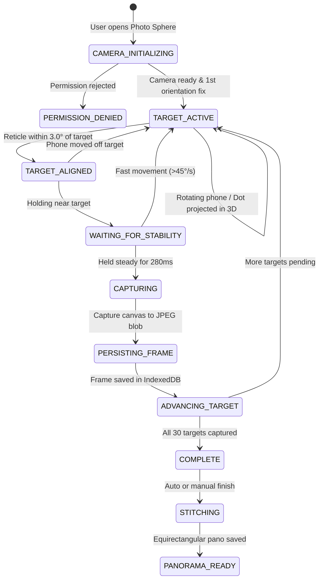

# Google Camera Photo Sphere Implementation Plan & Architecture Specification (Phase 2)

**Authoritative Reverse-Engineered Reference:** `C:\Users\vanji\OneDrive\Documents\APK`  
**Phase 1 Source Investigation Report:** `C:\Users\vanji\OneDrive\Documents\APK\PHOTOSPHERE_IMPLEMENTATION_ANALYSIS.md`  
**Target Project:** `E:\Vanji\7days-Field`  
**Date:** October 2026  
**Status:** Architecture Proposal & Staged Implementation Plan (Awaiting User Approval)

---

## 1. Executive Summary & Objective

This document defines the complete architectural design, component responsibilities, platform feasibility assessment, and staged implementation plan to recreate the **Google Camera Photo Sphere ("LightCycle")** feature inside **7Days Field Supervisor** (`E:\Vanji\7days-Field`).

The primary objective is to reproduce the **authentic behavioral and mathematical characteristics** of Google Camera's Photo Sphere mode:
1. Continuous live rear-camera viewfinder.
2. Stationary center alignment reticle.
3. Rigid 3D target coordinates projected via rotation matrix transformation.
4. Strictly **one active blue guidance target dot** at a time; no floating green dots for captured frames.
5. Strict frustum culling: targets behind the camera plane ($Z_{\text{cam}} \ge -0.05$) are never rendered.
6. Angular velocity stability detection ("Hold camera still • Moving too fast") that blocks premature captures.
7. Automatic shutter triggering on alignment ($\le 3.0^\circ$) + stability hold.
8. Deterministic full-sphere progression (equator $\to$ upper $\to$ zenith $\to$ lower $\to$ nadir).
9. IndexedDB offline persistence of raw frames and session states.
10. Equirectangular spherical panorama stitching with Google Photo Sphere XMP metadata injection (`GPano:UsePanoramaViewer`).
11. Interactive Three.js spherical viewer with device orientation tracking and stereoscopic split-screen Cardboard VR mode.

---

## 2. Current Application Architecture Audit (`E:\Vanji\7days-Field`)

| Dimension | Current Project State |
|---|---|
| **Runtime & Framework** | Progressive Web App (PWA) / Single Page Application built on **React 19.2.8** + **Vite 8.3.0**. |
| **Styling & Icons** | Vanilla CSS + inline dynamic styles, `lucide-react` icons. |
| **Graphics & 3D Engine** | **Three.js v0.186.1** already installed in `package.json`. |
| **Local Persistence** | **idb v8.0.3** (IndexedDB wrapper) already installed. |
| **Testing Harness** | **Vitest v5.0.4** with passing suites. |
| **Camera Access** | HTML5 `navigator.mediaDevices.getUserMedia({ video: { facingMode: 'environment' } })`. |
| **Sensors** | HTML5 `DeviceOrientationEvent` (alpha, beta, gamma) & `DeviceMotionEvent`. |

### Existing Photo Sphere Modules in `src/features/photo-sphere/`:
- `PhotoSphereCapture.jsx`: Viewfinder, state machine, alignment tick, auto-capture trigger, camera constraints.
- `PhotoSphereTargets.js`: 3D unit vector generation, 3x3 camera rotation matrix, frustum culling, sequence selection.
- `PhotoSphereOrientation.js`: Orientation tracking, relative yaw calibration, angular velocity calculation.
- `PhotoSphereStitcher.js`: Multi-frame equirectangular canvas projection.
- `components/AlignmentReticle.jsx`: 4-quadrant alignment ring with green lock animation.
- `components/TargetDotsOverlay.jsx`: Single blue target dot renderer with smooth scale and edge indicator.
- `components/MotionSensorViewer.jsx`: Three.js navigable internal sphere with device orientation sensor sync.
- `components/VRViewer.jsx`: Stereoscopic split-screen viewer with inter-pupillary offset.
- `storage/PhotoSphereStorage.js`: IndexedDB schema for sessions, frames, and stitched panoramas.

---

## 3. Platform Feasibility & Technical Decisions

### 3.1 Web/PWA vs. Native Android APK
The original APK relies on native C++ (`liblightcycle.so`) and Android Camera2 NDK. Our application runs as a mobile web / PWA application on modern Android mobile browsers (Chrome / WebKit).

| Capability | Original APK Mechanism | Web / PWA Implementation in `7days-Field` | Feasibility & Performance |
|---|---|---|---|
| **Rear Camera** | Camera2 API / NV21 preview | `getUserMedia({ video: { facingMode: 'environment' } })` | **100% Feasible:** High-framerate (60fps) hardware-accelerated preview. |
| **Orientation Tracking** | Android SensorManager (`TYPE_GYROSCOPE`, `TYPE_ACCELEROMETER`) | `window.addEventListener('deviceorientation')` | **100% Feasible:** High-frequency orientation updates with absolute/relative yaw calibration. |
| **3D Matrix Projection** | Native OpenGL ES 2.0 (`Matrix.multiplyMM`) | Pure JS 3D vector / matrix transforms in `PhotoSphereTargets.js` | **100% Feasible:** Sub-millisecond compute per frame. |
| **Behind Culling** | Frustum clipping in vertex shader | Plane culling in JS ($Z_{\text{cam}} \ge -0.05 \implies \text{culled}$) | **100% Feasible:** Verified by unit tests. |
| **Stitching Engine** | Ceres Solver C++ bundle adjustment in `liblightcycle.so` | HTML5 2D Canvas equirectangular projection & spherical warping | **Feasible for Mobile Web:** Produces high-resolution equirectangular 2:1 panoramas without native compilation. |
| **Photo Sphere Metadata** | Native XMP writer `mfa.java` (`GPano`) | Client-side JPEG XMP header injection | **Feasible:** Injects standard GPano XML into output blob. |
| **360° Panorama Viewer** | External viewer (Google Photos) via `GPano` | Three.js `SphereGeometry` with inverted normals | **100% Feasible:** 60fps GPU WebGL rendering. |
| **Motion-Sensor Viewing** | Sensor-driven camera matrix | Three.js `DeviceOrientation` quaternion/Euler mapping | **100% Feasible:** Interactive physical rotation. |
| **VR Split-Screen** | Cardboard SDK / VR Activity | Dual Three.js camera viewports with IPD offset | **100% Feasible:** Stereoscopic Cardboard rendering. |

---

## 4. Component Responsibilities & System Architecture

```
src/features/photo-sphere/
├── PhotoSphereCapture.jsx          # Session state machine, camera loop, auto-capture trigger
├── PhotoSphereTargets.js           # 3D vector/matrix math, frustum culling, sequence progression
├── PhotoSphereOrientation.js       # IMU sensor fusion, reference heading, angular velocity guard
├── PhotoSphereStitcher.js          # Canvas equirectangular projection, seam blending, XMP injection
├── storage/
│   └── PhotoSphereStorage.js       # IndexedDB persistence (sessions, frames, blobs)
└── components/
    ├── AlignmentReticle.jsx        # Stationary 4-quadrant reticle
    ├── TargetDotsOverlay.jsx       # Single blue guidance dot & peripheral indicator
    ├── MotionSensorViewer.jsx      # Three.js 360° motion-sensor panorama viewer
    ├── VRViewer.jsx                # Three.js Cardboard stereoscopic split-screen viewer
    └── PanoramaResultScreen.jsx    # Session preview, re-stitch, and evidence save actions
```

### Component Responsibility Breakdown:

1. **`PhotoSphereTargets.js` (Target Generator & Projection):**
   - World coordinate system: $+X$ (Right), $+Y$ (Zenith), $-Z$ (Bore sight).
   - Generates 30 coverage targets: Horizon (10), Upper (8), Zenith (2), Lower (8), Nadir (2).
   - Computes camera matrix $\mathbf{R}_{\text{cam}}$ from (yaw, pitch, roll).
   - Transforms target unit vector: $\mathbf{V}_{\text{cam}} = \mathbf{R}_{\text{cam}}^T \cdot \mathbf{V}_{\text{world}}$.
   - Frustum culling: if $Z_{\text{cam}} \ge -0.05$, target is behind camera $\implies \text{visible} = \text{false}$.
   - Perspective projection: maps $(X_c, Y_c, Z_c)$ to viewport pixels using lens FOV.

2. **`PhotoSphereOrientation.js` (Orientation & Motion Guard):**
   - Subscribes to `deviceorientation`.
   - Calibrates `referenceHeading` on session start so target 0 aligns with user's initial view.
   - Computes device angular velocity $\omega = \frac{\Delta\theta}{\Delta t}$.
   - Sets `isMovingTooFast = true` if $\omega > 45^\circ/\text{s}$.

3. **`PhotoSphereCapture.jsx` (Session & Auto-Capture Controller):**
   - Camera initialization with relaxed constraints and robust error handling.
   - Evaluates alignment: $\theta_{\text{err}} \le 3.0^\circ$ (matching APK `SetTargetHitAngleRadians`).
   - Evaluates stability: hold steady for 280ms without `isMovingTooFast`.
   - Single-fire auto-capture: captures high-resolution canvas frame, writes to IndexedDB, locks capture state, advances to next target.

4. **`PhotoSphereStitcher.js` (Equirectangular Blender & XMP Injector):**
   - Decodes captured frames into `ImageBitmap`.
   - Projects each frame onto a 2:1 equirectangular canvas ($2048 \times 1024$ or $4096 \times 2048$) based on spherical yaw/pitch coordinates.
   - Applies cosine feathering across frame boundaries.
   - Injects standard Google Photo Sphere XMP metadata (`http://ns.google.com/photos/1.0/panorama/`, namespace `GPano`).

5. **`MotionSensorViewer.jsx` & `VRViewer.jsx` (Spherical Viewers):**
   - Uses Three.js `SphereGeometry(500, 60, 40)` scaled $(-1, 1, 1)$ with equirectangular texture.
   - In `MotionSensorViewer`: device rotation dynamically drives the virtual camera's orientation.
   - In `VRViewer`: two side-by-side viewports with $64\text{mm}$ inter-pupillary distance offset for Cardboard VR headsets.

---

## 5. Detailed Capture & Persistence Lifecycle



---

## 6. Staged Implementation Plan (Phase 2 Milestones)

### Milestone 1 — Target Projection & Viewfinder Guidance (Verification & Polish)
- [x] 3D rotation matrix projection in `PhotoSphereTargets.js`.
- [x] Behind-camera plane culling ($Z_{\text{cam}} \ge -0.05$).
- [x] Strictly one active blue target dot rendered on viewfinder.
- [x] Zero floating green dots.
- [x] Alignment threshold locked at $3.0^\circ$.
- [x] Motion stability guard with "Hold camera still • Moving too fast" banner.

### Milestone 2 — Google Photo Sphere XMP Metadata Injection
- [ ] Implement `injectGPanoMetadata(jpegBlob, panoWidth, panoHeight)` in `PhotoSphereStorage.js`.
- [ ] Add standard XMP packets:
  - `http://ns.google.com/photos/1.0/panorama/`
  - `GPano:UsePanoramaViewer="True"`
  - `GPano:IsPhotosphere="True"`
  - `GPano:CroppedAreaImageWidthPixels="W"`
  - `GPano:CroppedAreaImageHeightPixels="H"`
  - `GPano:FullPanoWidthPixels="W"`
  - `GPano:FullPanoHeightPixels="H"`
- [ ] Verify exported JPEGs open seamlessly in Google Photos and 360° viewer platforms.

### Milestone 3 — Enhanced Seam Blending & Polar Warping
- [ ] Add multi-band cosine alpha-feathering along frame overlap margins in `PhotoSphereStitcher.js`.
- [ ] Implement zenith ($+78^\circ$) and nadir ($-78^\circ$) radial warp to eliminate pole pinching.
- [ ] Add stitching progress bar updates (0% to 100%) and cancel safety.

### Milestone 4 — Motion-Sensor & VR Viewer Verification
- [ ] Validate Three.js `MotionSensorViewer.jsx` sensor listener lifecycle and smooth yaw/pitch tracking.
- [ ] Validate Three.js `VRViewer.jsx` dual-eye viewport rendering and clean WebGL context disposal.
- [ ] Verify pinch-to-zoom and touch drag fallback controls.

### Milestone 5 — Real Android Device Testing & Regression Suite
- [ ] Execute Vitest test suite (`tests/photosphere.test.js`).
- [ ] Run production build (`npm run build`).
- [ ] Test live on Android Chrome via HTTPS / Tailscale.
- [ ] Test complete 30-shot spherical capture session from target 0 to 29.
- [ ] Test session persistence across page reload.

---

## 7. Testing Strategy & Observable Acceptance Criteria

| ID | Test Scenario | Acceptance Criteria |
|---|---|---|
| **AC-1** | Initial View | Viewfinder shows rear camera preview, stationary center reticle, and exactly ONE blue target dot directly in front. No green dots. |
| **AC-2** | Target Anchoring | Rotating phone away moves dot across viewfinder according to real orientation. Turning 180° away hides dot completely (no arbitrary dot on screen). |
| **AC-3** | Alignment Lock | Bringing blue dot within reticle ($\le 3.0^\circ$) turns reticle green and starts circular progress fill. |
| **AC-4** | Motion Guard | Shaking/moving phone rapidly while aligned cancels progress and displays "Hold camera still • Moving too fast". |
| **AC-5** | Single-Fire Auto-Capture | Holding steady triggers shutter sound and white flash exactly once. Next adjacent target becomes active. |
| **AC-6** | Persistence | Captures are stored in IndexedDB. Refreshing page does not lose completed frames. |
| **AC-7** | Panorama Stitching | Tapping "Finish" stitches frames into a 2:1 equirectangular image with injected GPano XMP tags. |
| **AC-8** | Motion Viewer | Tapping "Motion View" opens 360° sphere; rotating physical phone rotates camera view in real time. |
| **AC-9** | VR Viewer | Tapping "VR View" opens split-screen stereoscopic view for Cardboard headsets with working head tracking. |

---

## 8. Risks, Dependencies, and Approvals Needed

1. **Camera Permission over Insecure Origins:**  
   HTML5 Camera and DeviceOrientation require HTTPS or `localhost`.  
   *Mitigation:* Vite is configured with `@vitejs/plugin-basic-ssl` and `vite-plugin-mkcert`.
2. **Device Orientation Permission on iOS:**  
   iOS 13+ requires `DeviceOrientationEvent.requestPermission()`.  
   *Mitigation:* Handled seamlessly in `PhotoSphereOrientation.js`.
3. **No Changes to Existing Project Code:**  
   Per Phase 2 requirements, no application files will be altered until you review and approve this plan.
